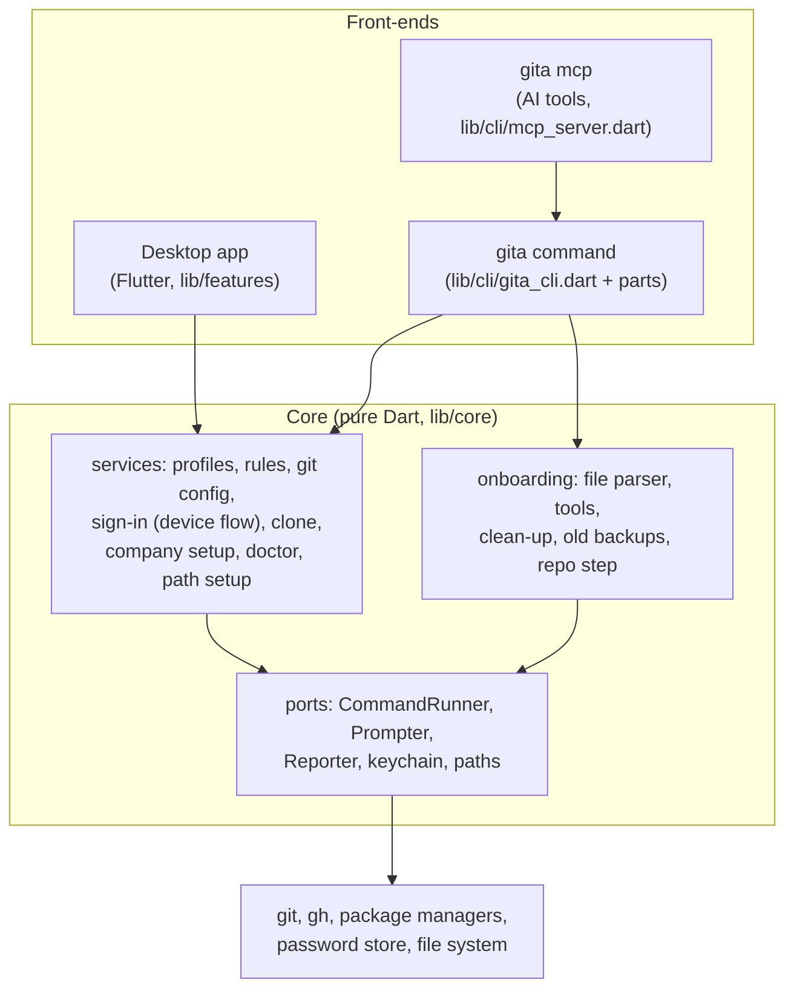
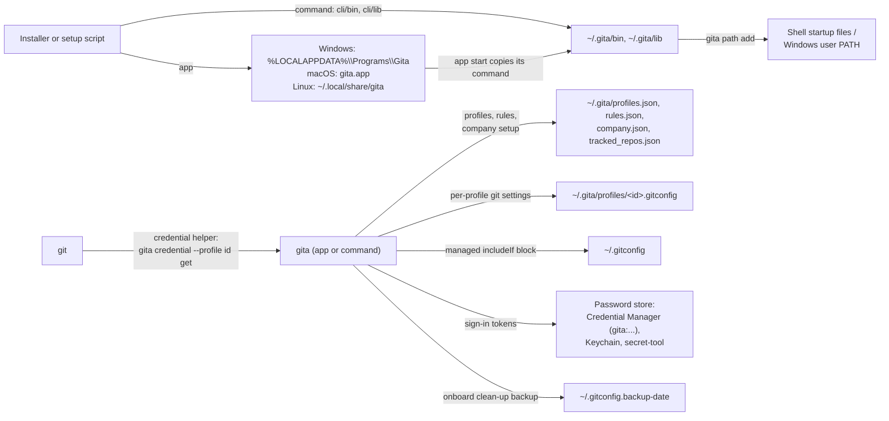
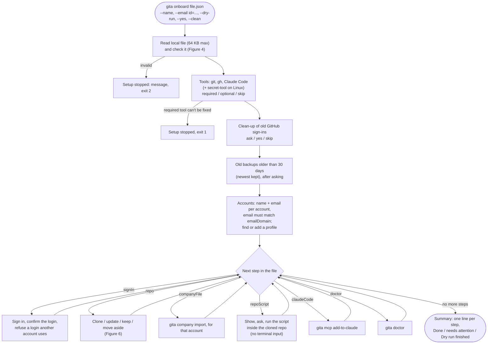
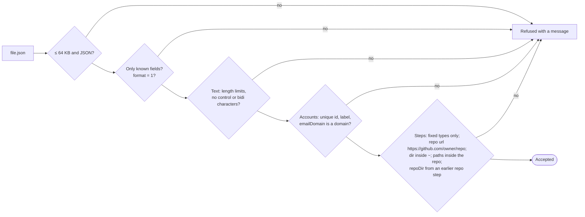
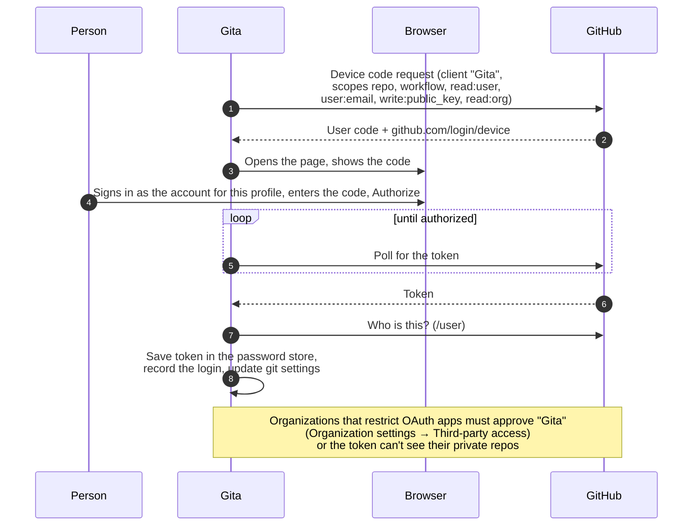
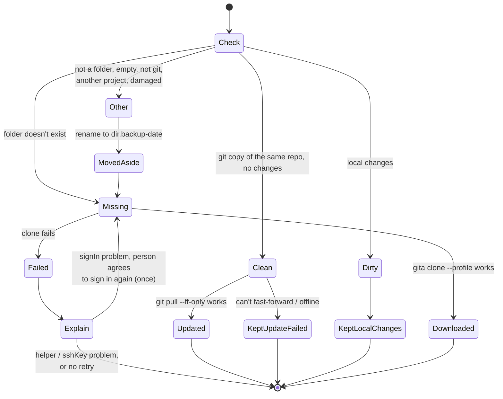
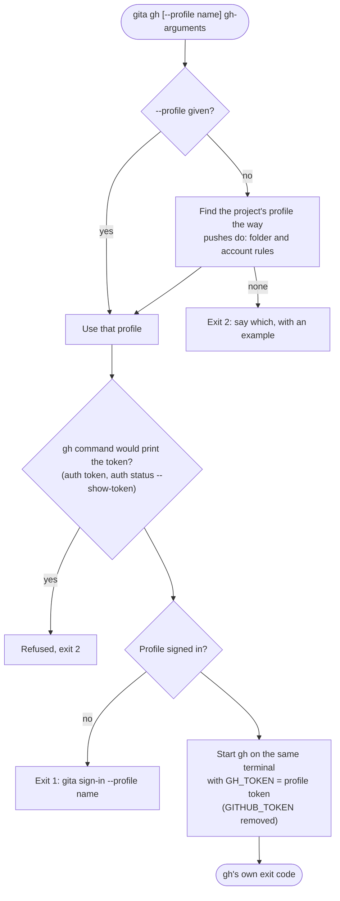
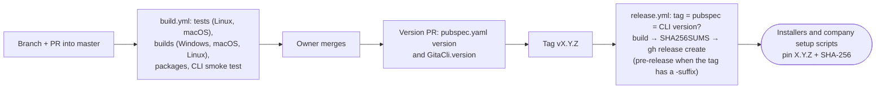

# Gita – Lifecycle and process flows

How Gita's command-line parts work end to end, with labelled diagrams: what goes where
and when. This covers `gita onboard`, sign-in, cloning, `gita gh`, the files Gita writes,
and how a release reaches people. User-facing docs: [README](../README.md),
[docs/onboarding.md](../docs/onboarding.md), [docs/company-rollout.md](../docs/company-rollout.md).
Every figure has a short "who / what / where / when" table.

Contents:
1. [Components](#1-components)
2. [What goes where on a computer](#2-what-goes-where-on-a-computer)
3. [`gita onboard` from start to finish](#3-gita-onboard-from-start-to-finish)
4. [Checking an onboarding file](#4-checking-an-onboarding-file)
5. [Signing a profile in to GitHub](#5-signing-a-profile-in-to-github)
6. [The repo step and failed clones](#6-the-repo-step-and-failed-clones)
7. [`gita gh`](#7-gita-gh)
8. [From a change to a release](#8-from-a-change-to-a-release)
9. [History](#9-history)

---

## 1. Components

*Figure 1 – Front-ends call the same core; the core reaches the machine only through ports
(so tests use fakes).*

| Piece | Where | Used when |
|---|---|---|
| Desktop app | `lib/features/`, `lib/app/` | People manage profiles and rules by hand |
| `gita` command | `lib/cli/` (`onboard_command.dart`, `gh_command.dart`, `manage_commands.dart`) | Scripts, hooks, git's credential helper, onboarding |
| Onboarding core | `lib/core/onboarding/` | `gita onboard` |

---

## 2. What goes where on a computer

*Figure 2 – Files Gita and its installers write.*

| Item | Path | Written by | When |
|---|---|---|---|
| Command | `~/.gita/bin`, `~/.gita/lib` | Installer, app start | Install, every app start |
| Profiles, rules | `~/.gita/*.json` | App, `gita profile/rule/company/onboard` | When changed |
| Git settings | `~/.gitconfig` managed block, `~/.gita/profiles/<id>.gitconfig` | Gita | When rules or profiles change |
| Tokens | Password store, one per profile | Sign-in | Sign-in |
| Backups | `~/.gitconfig.backup-<date>`, `<repo>.backup-<date>` | `gita onboard` | Before removing settings / moving a folder |

---

## 3. `gita onboard` from start to finish

*Figure 3 – Order of work in `gita onboard`. A step that can't go on stops the run with
"Setup stopped:" and exit code 1; the summary is printed either way.*

| Who / what | What | Where | When |
|---|---|---|---|
| Company | Writes the onboarding file once | Any repo or folder; given to Gita as a local path | When their setup changes |
| Developer (or a company script) | Runs `gita onboard <file>` | Terminal | New computer; again to repair |
| Gita | Runs the steps above | This computer | Each run (finished steps are skipped) |

---

## 4. Checking an onboarding file

*Figure 4 – `OnboardingFile.parse` (`lib/core/onboarding/onboarding_file.dart`). Nothing in
the file can run an arbitrary command.*

---

## 5. Signing a profile in to GitHub

*Figure 5 – Device-flow sign-in (`lib/core/services/github_device_flow.dart`).*

---

## 6. The repo step and failed clones

*Figure 6 – States of the repo step (`lib/core/onboarding/repo_step.dart`). A failed clone
removes the partial folder. The explanation follows the problem `gita clone --json`
reports: `signIn` lists the likely causes (organization approval of the Gita app first,
wrong account, not a member, no connection); `helper` says git never got a sign-in from
Gita (run `gita doctor --fix`); `sshKey` says the SSH key was refused.*

---

## 7. `gita gh`

*Figure 7 – `gita gh` (`lib/cli/gh_command.dart`). The token only goes into gh's
environment for that one command; gh's own login isn't used or changed.*

---

## 8. From a change to a release

*Figure 8 – Release flow (`.github/workflows/build.yml`, `release.yml`). `SHA256SUMS` is
added by PR #27, so scripts that pin a version can check new releases.*

---

## 9. History

| Date | PR / release | What |
|---|---|---|
| 2026-11-07 | 1.0.0 – 1.0.2 | First releases, installers, MIT licence (#19, #20) |
| 2026-11-09 | #21 | macOS: bundled command signed with the entitlement the Dart runtime needs (no more "Killed: 9") |
| 2026-11-09 | #22 | macOS test fixes; macOS tests block merges |
| 2026-11-09 | #23 | `gita gh` |
| 2026-11-09 | #24 | `gita` command on PATH for new terminals (`gita path`) |
| 2026-11-09 | #25 | Clone window offers the fix when a clone can't sign in; clone errors classified |
| 2026-11-09 | 1.0.3 | Release with #21–#25 |
| 2026-11-09 | #27 (open) | `gita onboard`, clean-up, old backups, `read:org`, `SHA256SUMS`, isolated smoke test |
