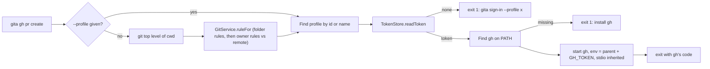

# v1.1.0 — Change Request: gita gh

| | |
|---|---|
| **CR id** | CR-0001 |
| **Version** | 1.1.0 (proposed; see open questions) |
| **Status** | In progress |
| **Owner** | naseebnaushad |
| **Branch** | `feature/gita-gh` |
| **Date** | 2026-11-09 |

## 1. Summary
The GitHub CLI (`gh`) has one global login, so `gh pr create` in a project that
belongs to another of the user's GitHub accounts acts as the wrong account. Git
pushes don't have this problem because Gita is git's credential helper per
profile. `gita gh <args>` runs `gh` with `GH_TOKEN` set — in the child process
only — to the saved GitHub sign-in of the profile that owns the current project,
so `gh` follows the same per-folder account choice as `git push`, with no
`gh auth login` / `gh auth switch`.

## 2. Answers to the clarifying questions
The requirements came from the developer in the brief for this work.

| Topic | Answer |
|---|---|
| Goal | `gh` acts as the account that owns the project, like git pushes already do. |
| Users | People with several GitHub accounts on one computer, and AI coding agents working in their projects. macOS, Windows, Linux. |
| In scope | `gita gh [--profile <name or id>] <gh args...>`; help text; README; agent guidance (MCP instructions, Claude Code skill). |
| Out of scope | Changing `gh`'s own login or config; GitHub Enterprise Server hosts (Gita's sign-in is github.com only); an MCP tool that runs `gh`. |
| Edge cases | No rule matches and no `--profile` → explain, exit 2 (as `gita clone`). Not a git project and no `--profile` → explain, exit 2. Unknown `--profile` → exit 2. Profile not signed in → point to `gita sign-in --profile <x>`, exit 1. Password store unreachable → say so, exit 1. `gh` not installed → say how to install, exit 1. `gh auth token` / `--show-token` → refused, exit 2. Otherwise `gh`'s exit code is passed through. |
| Constraints | Never print, log or persist the token. Pure Dart (CLI is compiled with `dart compile exe`). No new dependencies. |
| Definition of done | Command works and is unit-tested with a fake `gh` on PATH; `flutter analyze` clean; `flutter test` passes; help and README updated; PR opened against `master`. |

## 3. Impact analysis
| Area / file | How it is affected | Action |
|---|---|---|
| `lib/cli/gita_cli.dart` | New `gh` command, intercepted before argument parsing so `gh`'s own flags (including `--json`, `--help`) reach `gh`. New injectable `runInteractive` and `environment` for tests. Help text. | change |
| `lib/core/services/git_service.dart` (`topLevel`, `ruleFor`) | Reused unchanged for profile resolution (folder rules, then account/org rules against the remote). | none |
| `lib/core/services/token_store.dart` | Reused unchanged (`readToken`). | none |
| `bin/gita.dart` | Unchanged; `exitCode` already carries the command's code. | none |
| `lib/cli/mcp_server.dart` | Instructions tell agents to use `gita gh` instead of `gh`. No new tool. | change |
| `claude-plugin/skills/gita/SKILL.md` | Same guidance for Claude Code. | change |
| `README.md` | Command list and a "GitHub CLI with the right account" section. | change |
| `test/unit/gita_gh_test.dart` | New tests. | test |
| `test/unit/mcp_server_test.dart` | Checked that instruction text isn't asserted verbatim. | none |
| Desktop app (Flutter UI) | Not affected. | none |

Suggested related improvements (not in scope unless approved):
- An optional `gita gh setup` that installs a shell alias/function so plain `gh` goes through Gita.

## 4. Design

### Decisions
| # | Decision | Reason | Alternatives considered |
|---|---|---|---|
| D1 | Handle `gh` before Gita's argument parser; only a leading `--profile <x>` / `--profile=<x>` (and an optional `--`) belong to Gita, everything else goes to `gh` verbatim. | `gh` has its own `--json`, `--help`, `--repo` etc.; the `args` parser would reject or swallow them. | `ArgParser(allowTrailingOptions: false)` — still rejects unknown leading options like `gita gh --version`. |
| D2 | `GH_TOKEN` is set only in the child's environment; `GITHUB_TOKEN` is removed from it. | Token never leaves the process tree; `GH_TOKEN` already wins over `GITHUB_TOKEN`, removing it avoids confusion in `gh` extensions that read `GITHUB_TOKEN` first. | Writing to `gh`'s hosts.yml — global, persistent, and races between folders. |
| D3 | Find `gh` on PATH ourselves and start it by full path, without a shell, with stdio inherited. | Clear "not installed" message on every OS; no shell means `gh` arguments are never interpreted by `cmd.exe` (injection-safe on Windows). | `runInShell: true` on Windows — arguments with `&`/`|` would be run by cmd. |
| D4 | Refuse `gita gh auth token` and `--show-token`/`-t` on `auth status`. | Those print the token; the command's promise is that Gita never shows it (and AI agents run this command). | Allow and document. |
| D5 | **No `gita gh-token`.** | It prints a secret to stdout, which lands in terminals, logs and AI agent transcripts; `gita gh` covers the `gh` use case, including `gh` extensions. | Add it with a warning (the brief left this to judgement). |
| D6 | **No MCP tool.** | Agents run shell commands anyway; an MCP tool that runs arbitrary `gh` commands is a broad surface for little gain. MCP instructions point agents to `gita gh`. | `gita_gh` tool. |
| D7 | Not in a git project, or no rule matches, and no `--profile` → exit 2 with the same wording style as `gita clone`. | Never guess an account. | Fall back to `gh`'s own login — would silently use the wrong account. |
| D8 | Profile not found by `--profile` → exit 2 listing profiles (as `gita clone`). | Consistency. | — |

## 5. Feature parity
Not a rewrite; existing commands are unchanged.

## 6. Security checklist
- [x] Input validated at boundaries (`--profile` must name an existing profile; `gh` arguments passed as an argv list, never through a shell)
- [x] Output encoded for context — N/A (CLI text)
- [x] AuthZ: uses only the token of the profile that owns the folder (or the one named)
- [x] Secrets never logged/printed/persisted; token only in the child environment; `auth token` refused
- [x] Errors are plain and contain no token
- [x] TLS + timeouts — N/A (no network calls by Gita; `gh` does its own)
- [x] No new dependencies
- [ ] Vulnerability scan — not run: no dependency changes, and Dart has no built-in audit command

## 7. Dependencies
None added.

## 8. Test approach
Unit tests in `test/unit/gita_gh_test.dart`, with a temp HOME, an in-memory
keychain, `GIT_CONFIG_GLOBAL`/`GIT_CONFIG_SYSTEM` overrides and a fake `gh`
script on a temp PATH that reports whether `GH_TOKEN` was set (and whether it
equals the expected test value) without printing it. One test drives the real
default runner (inherited stdio) to check exit-code pass-through. No real `gh`
and no real tokens.

## 9. Open questions
- Version: the repo keeps its version in `pubspec.yaml` and `GitaCli.version`
  (no `VERSION` file) and bumps in a separate "Bump to X.Y.Z" commit at release
  time. This change proposes 1.1.0 but leaves the bump to that release step.
- The company standard's `documents/` folder is new to this repo (it has a
  `docs/` folder for user docs). This CR starts `documents/`.

## 10. Change history
| Date | Version | Change |
|---|---|---|
| 2026-11-09 | 1.1.0 | CR created from the developer's brief; implementation started on the brief's go-ahead. |
| 2026-11-09 | 1.1.0 | Implemented; 17 new tests pass. `--profile` and `--` before the gh command only. |
