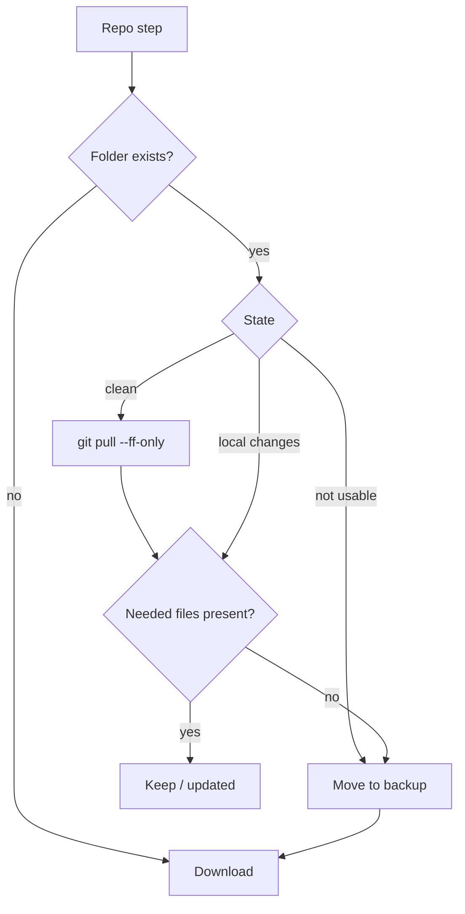

# v1.1.2 - Change Request: onboard repair

| | |
|---|---|
| **CR id** | CR-1.1.2-01 |
| **Version** | 1.1.2 (target; Alpha) |
| **Status** | Approved (2026-11-10) |
| **Owner** | Naseeb |
| **Branch** | `fix/onboard-repair` (from `master`) |
| **Date** | 2026-11-10 |

## 1. Summary
A setup that went wrong should be fixed by running the same setup command again. `gita onboard` already skips the steps that are finished. With this change it also checks what each company repository is missing, and sets up only those parts again.

The case that fails today:
- A company repository (for example `~/claude-standards`) has local changes, so it is left as it is ("kept (local changes)").
- It is also missing a file that a later step needs (for example `gita/thoughtbox.json`).
- The company-file step then stops with "It may be an old copy".

After this change, such a copy is moved to `<folder>.backup-<date>` (nothing is lost) and a fresh copy is downloaded.

The Dashboard **Remove** feature was split out to `CR-1.2.0-01` (Gita 1.2.0), so the repair can ship sooner.

## 2. Answers to the clarifying questions
| Topic | Answer |
|---|---|
| Goal | People whose install went wrong rerun the one-line installer and end up with a working setup, with no manual folder moves. |
| Users | Everyone onboarded with dev-setup's `install.sh` / `install.ps1` (which run `gita onboard`), on macOS, Windows and Linux. |
| In scope | The repo step checks for the files that later steps need from that repository (company files, and scripts for this system). A copy missing any of them is moved aside and downloaded again, even with local changes. The final summary says so. |
| Out of scope | Dashboard Remove (1.2.0). Deleting folders. A "wipe and reinstall everything" mode. New flags. The dev-setup change that pins Gita 1.1.2 (separate PR after the release). |
| Edge cases | **Copy has local changes and every needed file:** kept, as today. **Clean copy that a `git pull` fixes:** updated, not moved. **Folder in use, so it can't be moved:** stop with the existing "Close any program using that folder" hint. **Dry run:** says what it would do and changes nothing. **Download fails after the move:** the backup stays, and the existing failure help is shown. |
| Constraints | Never delete user data. Backups are named `<folder>.backup-<date>`, and the existing old-backups step offers to delete them after 30 days. No new dependencies. Core code stays pure Dart. |
| Definition of done | Unit tests cover the new cases and pass. The existing repo-step and onboard tests still pass. `flutter analyze` is clean. Docs are updated. A change note is written. A manual check reproduces the failing case and shows it repaired. |

## 3. Impact analysis
| Area / file | How it is affected | Action |
|---|---|---|
| `lib/core/onboarding/repo_step.dart` | `ensure()` takes `needs`: the files later steps need, as paths inside the repository. After the update, or for a copy with local changes, it checks them. Missing files mean the copy is moved aside and downloaded again. | change · test |
| `lib/cli/onboard_command.dart` (`RepoStep` case) | Collects `needs` from the `CompanyFileStep` and `RepoScriptStep` entries for the same folder (scripts only for this system). The checks that follow ("It may be an old copy") stay as a safety net. | change · test |
| `lib/core/onboarding/old_backups.dart` | Already finds and offers to delete `<repo>.backup-<date>` folders. | none |
| `test/unit/onboarding_repo_step_test.dart` | New cases. | test |
| `test/unit/cli_onboard_test.dart` | Existing onboard runs must still pass. | test |
| `docs/onboarding.md`, `README.md` (onboard section), `documents/Lifecycle and process flows.md` | Describe the repair. | change |
| dev-setup `install.sh` / `install.ps1` (other repo) | Pin Gita 1.1.2 after release. Then rerunning the one-liner performs the repair. | follow-up PR |

## 4. Design

### Decisions
| # | Decision | Reason | Alternatives considered |
|---|---|---|---|
| D1 | The repair runs automatically in `gita onboard`. There is no new flag. | The developer asked to "check what is missing first, and resetup those". Rerunning the installer is the reinstall. | A `--repair` flag (people would have to know about it). |
| D2 | "Missing" means a file that a later step in the onboarding file needs from that repository is absent. | Exact and cheap. A copy that has what is needed is left alone. | Compare with the remote (needs network). Always download again (loses work, slow). |
| D3 | A copy that is missing files is moved to `<folder>.backup-<date>` without asking, and downloaded again. | No data loss, because the backup keeps everything. Installs often run without anyone at the keyboard. It matches how unusable copies are handled today. | Ask first. `git stash`. |
| D4 | The check runs after the update attempt. | An old clean copy that a fast-forward fixes is not moved. | Check before the update. |
| D5 | The branch comes off `master` and the PR goes into `master`, as Gita has done so far. | Gita has no `develop` branch. | — |

## 5. Feature parity
| # | Existing behaviour | Test | Status |
|---|---|---|---|
| P1 | A clean copy is updated with `pull --ff-only`. | `clean copy: updated…` | ☐ |
| P2 | A copy with local changes that has every needed file is kept. | `local changes: kept with a warning` | ☐ |
| P3 | Unusable copies are moved aside. | existing move-aside tests | ☐ |
| P4 | Dry run changes nothing. | `dry run changes nothing` group | ☐ |
| P5 | A diverged copy that has every needed file is kept (update failed). | `diverged copy…` | ☐ |

## 6. Security checklist
- [ ] Needed paths come from the onboarding file and are checked to stay inside the repository folder (`_insideFolder`), as before.
- [ ] Nothing is deleted. Moves only.
- [ ] No secrets are logged.
- [ ] Git runs with no prompts and with timeouts (unchanged).
- [ ] No new dependencies.

## 7. Dependencies
None.

## 8. Test approach
Unit tests in `onboarding_repo_step_test.dart`:
- Local changes and a needed file missing → moved and downloaded.
- Local changes and every needed file present → kept.
- Clean copy where the pull brings the file → updated, not moved.
- Diverged copy missing a file → moved and downloaded.
- Dry run with a file missing → nothing changed.

Then the full test suite and `flutter analyze`.

## 9. Open questions
None open. These were settled on 2026-11-10:
- Ship the repair first as 1.1.2.
- Move the copy without asking.
- Branch off `master`.

## 10. Change history
| Date | Version | Change |
|---|---|---|
| 2026-11-10 | 1.1.2-alpha | CR created and approved. The repair was split from the Dashboard Remove CR (now CR-1.2.0-01). |
